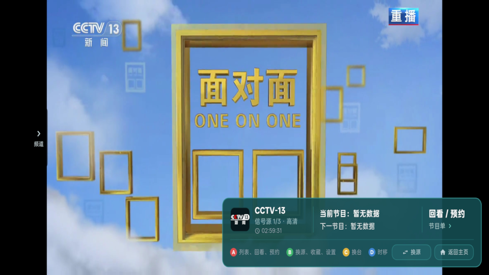
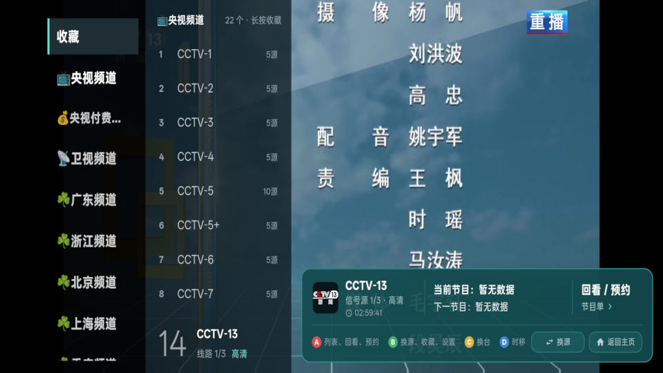
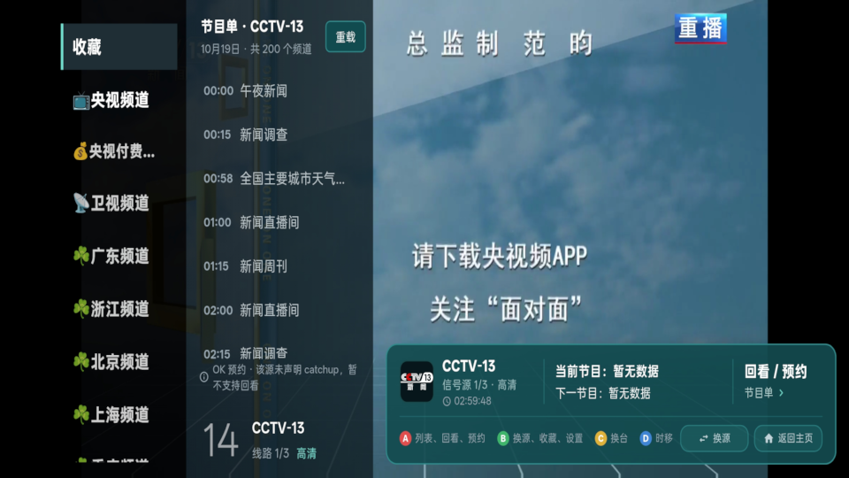

<p align="center">
  
</p>

<h1 align="center">电视（ChengTV）</h1>

<p align="center">
  <a href="https://github.com/mychb112/chengtv/releases/latest"></a>
  
  
</p>

自己写的安卓电视直播播放器。手机、平板、电视盒子/智能电视通用，同一套交互同时支持触屏和遥控器。

**本应用不内置任何直播源。** 频道内容由你导入自己的 M3U / M3U8 播放列表，播放什么完全取决于你的源。

## 界面预览

| 直播播放 | 频道列表 | 节目单 / 回看 |
| :---: | :---: | :---: |
|  |  |  |

截图都放在 `docs/images/`，用同名文件覆盖即可更新；新增图片的写法见 [docs/images/README.md](docs/images/README.md)。

## 构建产物

| 文件 | 说明 |
| --- | --- |
| `build/app/outputs/flutter-apk/app-release.apk` | 通用包，同时包含 `arm64-v8a` + `armeabi-v7a`，安卓 7.0 (API 24) 及以上 |

安装时系统会自动挑选匹配的 ABI：64 位设备用 arm64 原生库，32 位设备/老电视盒子用 armv7。

当前版本 **1.15.0 (build 15)**，版本号由系统 `PackageManager` 读取，界面显示与安装包内一致。

直播源与节目单订阅可参考
- 直播信号源
- https://github.com/Guovin/iptv-api/releases/download/playlist-latest/result.m3u
- 节目单订阅源 
- http://epg.51zmt.top:8000/e.xml.gz


## 版本记录

### 1.15.0 (build 15)

- **信息栏「回看 / 预约」不再被截成「回看 / …」**：与 1.13.0 频道列表同因——系统字体倍率放大后，固定列宽放不下。右下信息栏（台标 / 当前·下一节目 / 回看预约 / 四色键提示 / 换源 / 返回主页）整体用 `MediaQuery.withNoTextScaling` 锁定设计字号，不再跟随系统字体缩放
- 「回看 / 预约」再加一层 `AutoFitText` 兜底（14→11），遇到更宽的字体也只缩字号、不打省略号
- 该按钮列宽 62 / 74 / 86 → 68 / 80 / 94 dp，按 6 个字形留足余量

### 1.14.0 (build 14)

- **「全部信号源不可用」界面新增「关闭」按钮**：排在「下一个频道」后面，四个按钮按内容宽度排列、整体在屏幕水平居中；窄屏放不下一行时自动换行且仍居中
- 关闭后回到播放界面，并直接把频道列表打开，可以立刻换台；列表仍按原有规则 5 秒无操作自动收起
- 关闭时会彻底停掉出错的播放器（取消看门狗、注销监听、释放 controller、作废进行中的重试），否则 error 状态会立刻再触发一次失败流程，遮罩刚关掉又弹回来

### 1.13.0 (build 13)

- **分类栏与频道列表彻底不跟随系统字体倍率**：1.12.0 的「按宽度收缩」在测量时仍要乘系统字体倍率，字体调到 2 倍的设备上即使缩到最小号也依然溢出，看到的还是「央视…」。这类固定列宽的导航骨架本就不该跟系统字体变，现在左侧分类栏和整个频道面板（频道列表 / 信号源 / 节目单）局部用 `MediaQuery.withNoTextScaling` 锁定设计字号，任何设备上都是 16 / 13.5 号
- **`AutoFitText` 支持折行**：改为按 `maxLines` 排版并判断 `didExceedMaxLines`，频道名放不下时优先折成两行（比省略号更容易看清），两行仍放不下才缩小字号
- 分类栏宽度 140→148（大屏 168→176），给中文字更多横向余量
- 新增 2 条测试（共 24 条）：特大字体下锁定设计字号、允许两行时优先折行

### 1.12.0 (build 12)

- **分类栏与列表文字自适应字号**：部分设备把系统字体调大后，分类名被截成「央视…」。新增 `AutoFitText`：设计字号放得下就原样显示，放不下按二分法缩到能容纳的最大字号（分类栏 16→12、列表行 13.5→10.5），最小字号仍放不下才省略
- **系统字体缩放夹在 0.9~1.25**：播放器、分类栏、频道列表都是固定宽度密集布局，放任 2 倍缩放必然截断；整个应用统一夹住，配合上一条的局部自适应
- 新增 4 条 widget 测试覆盖：宽度够保持原字号、宽度不足自动缩小、系统放大时收缩、缩到最小仍放不下时省略且不溢出

### 1.11.0 (build 11)

- **底排两个按钮改为均分剩余宽度**：原来「换源」「返回主页」按内容宽度靠右排，右侧留一片空白。现在提示文字按内容占位，剩下的宽度全部给这两个按钮、各占一半，点击区域明显变大，右边缘也不再空缺
- 按钮内部居中对齐，宽度够（≥66dp）显示「图标 + 文字」，不够自动只留图标，窄屏也不会挤爆

### 1.10.0 (build 10)

- **换台后操作栏自动消失**：上下滑动换台会唤出右下信息栏与左侧「频道」提示条，但原来没有重新计时，会一直挂在画面上。现在换台后同样按 5 秒计时，超时自动淡出，与面板闲置时长一致
- **底排新增「换源」按钮**：「时移」右边新增手动换源按钮，点一下切到下一个信号源，到最后一条再从头循环；频道只有一个信号源时按钮变灰，点击提示「该频道只有 1 个信号源」
- 底排改为可收缩布局（提示文字可省略），窄栏体下换源与返回主页自动收成纯图标，不会挤爆

### 1.9.0 (build 9)

- **启动直接进直播**：应用启动后不再停在频道主界面，自动找到 CCTV-13 新闻并开始播放；找不到该频道（列表里没有新闻频道）时仍停在首页
- **面板 5 秒自动收起**：频道列表 / 信号源 / 节目单弹出后，5 秒内没有触摸、滑动或遥控器按键就自动收起，避免长时间挡着画面；手机与电视同一套逻辑
- **改名与换图标**：应用名由「澄视」改为「电视」，图标重绘为拟物化老电视（木质箱体 + 米白面板 + 玻璃屏 + 镀铬旋钮 + 双天线），并补齐自适应图标（Android 8+ 任意形状遮罩不变形）与电视端 banner
- 启动画面由白底改为图标同色暖黑 + 居中图标，进播放前不再闪白

### 1.8.0 (build 8)

- **换台方向对调**：右侧上下滑动改为「上滑下一个频道、下滑上一个频道」，与遥控器 CH+ 方向一致
- **换台覆盖整个右侧**：右下信息栏本身也吃竖滑手势，栏体上滑动同样换台；单击信息栏仍是打开节目单（没有位移时点击优先）
- **频道列表长按 2 秒收藏**：播放页频道列表按住 2 秒收藏该频道，收藏后频道名后出现黄色五角星；「收藏」分类里同样按住 2 秒即取消收藏，星星消失、条目同时从收藏列表移除（收藏状态持久化，重启仍在）
- 列表表头显示「N 个 · 长按收藏 / 长按取消」作为操作提示
- **信息栏下排重排**：A/B/C/D 四个提示由等宽平铺改为紧凑靠左排列，「时移」紧挨「换台」；右侧空出的位置新增「返回主页」按钮，点击回到应用启动时的频道主界面（栏体窄时按钮自动收成图标）

### 1.7.0 (build 7)

- **换台手势改到右侧竖滑**：只有屏幕右半边的上下滑动才换台，上滑上一个频道、下滑下一个频道；左半边不再响应，翻频道列表或误触都不会切台。原来整屏左右滑动换台已移除
- 判定同时看滑动距离（≥60dp）和甩动速度（≥180px/s），慢滑和快甩都能触发
- **四色键提示回到信息栏**：A/B/C/D 四色键提示恢复，放在合并信息栏下半部分，与上排（台标 ｜ 节目 ｜ 回看预约）用一条横线分隔

### 1.6.0 (build 6)

- **右下角两框合并为一条**：台标信息、当前/下一节目、「回看 / 预约」入口合成一个横向信息栏，位置就是原来节目单框的右下角位置，三段之间用竖线分隔
- 左段：台标 + 频道名 + 信号源 x/y · 画质 + 时间；中段：当前节目 / 下一节目；右段：回看 / 预约（点击整条都能打开节目单）
- 整条宽度按屏幕一次算好（剩余宽度上限 640dp），面板开合不会让位置和宽度变化；窄屏时按钮与分隔自动收窄
- 原来节目条里的 A/B/C/D 四色键提示与独立时钟行取消，时钟移入左段第三行

### 1.5.0 (build 5)

- **挖孔避让改用系统真实数据**：新增原生方法 `getDisplayInfo`，直接读 `WindowInsets.displayCutout` 的安全区（dp）并回传 Dart。Android 15 起 targetSdk 35+ 强制边到边，内容会画进挖孔区，而沉浸模式下 `MediaQuery.padding` 常被清零，光靠 Flutter 侧拿不到尺寸
- **不再用屏幕宽度判断手机/平板**：横屏手机普遍 900dp 以上，原判断会把手机当平板导致完全不让位。现在只要有挖孔就避让（安全区 + 10dp），系统没报挖孔时手机留 24dp 兜底
- **左侧提示条同步右移**：`频道` 提示条跟随让位内边距，不再压在前置摄像头上
- **右侧位置纠正**：节目单框回到右下角原位置不动，「回看 / 预约」框上移到右侧偏上（`Alignment(1, -0.52)`），两框分离
- 屏幕旋转、回到前台都会重新读一次挖孔方向

### 1.4.0 (build 4)

- 左侧分类栏与频道面板尝试右移避让挖孔（按屏幕宽度判断，实测在横屏手机上失效，已被 1.5.0 取代）
- 右侧两框曾改为同列堆叠（方向理解有误，1.5.0 已恢复）

### 1.3.0 (build 3)

- 播放列表中的「更新时间 / 订阅地址 / 公告」等元信息行不再被当成频道，修掉点击后跳进第一个频道的假频道
- 频道/信号源/节目单面板表头移出列表，不再占用条目序号
- 直播画面默认「适应」原比例
- 「回看 / 预约」与节目单两框宽度只随屏幕自适应一次，面板开合不再重排

## 功能

- **播放列表**：链接订阅导入、本地 `.m3u/.m3u8/.txt` 文件导入，解析 `#EXTINF` 的 `tvg-name` / `tvg-logo` / `group-title`
- **多信号源合并**：同名频道自动合并为一条，卡片上标出「N源」；播放时按质量排序选源、5 秒无响应自动换源、也可手动切换
- **浏览**：左侧分类栏（平板/TV）+ 频道网格，手机竖屏自动切换为顶部横向分类条；频道搜索
- **收藏 / 最近播放 / 上次频道**：本地持久化，重启回到上次看的台
- **播放页**：左侧分类栏 + 频道/信号源/节目单面板（固定表头，不占条目序号）；右下角一体化信息栏＝台标信息 ｜ 当前/下一节目 ｜ 回看·预约
- **画面**：默认「适应」完整显示原始画面（留黑边、不裁切），右方向键可切「适应 / 铺满 / 4:3」
- **节目单（可选）**：导入 XMLTV 地址后显示当前/下一节目，支持预约提醒与回看（需源支持 catchup）
- **画面比例**：适应 / 铺满 / 4:3 拉伸三档
- **OSD**：6 秒无操作自动隐藏，任何按键/触摸唤出
- **横屏沉浸**：进入播放器自动横屏 + 隐藏系统栏，退出恢复

## 多信号源规则

1. **合并**：`tvg-id` 相同的条目合并；没有 `tvg-id` 时按归一化频道名合并（剔除 `高清/超清/4K/HD/蓝光/备用/测试/线路` 等画质与线路词、标点和括号注释）。显示名优先取不带画质后缀的那个。
2. **元信息过滤**：列表里 `更新时间：2026-10-18`、纯日期/时间、`订阅地址`、`扫码关注公众号`、`公告` 这类行会被识别为元信息并直接丢弃，不会混进频道列表（它们原来会显示成一个"频道"，点开其实播的是清单里第一条的地址）。
2. **选源顺序**：上次手动选择/成功播放的源 → 实测分辨率高的源 → 启发式评分高的源（画质词、HTTPS、HLS 加分；`备用/测试` 降权）。
3. **自动容错**：单条源 5 秒内没起来判定失败，立刻切下一条；播放中持续缓冲超过 5 秒或报错，同样自动切换。
4. **全部失败**：所有线路都试完后显示「全部信号源不可用」，可重新检测 / 手动选择线路 / 换下一个频道。
5. **手动切换**：播放页按 B 键 →「换源」，或直接按 S 键，列出全部线路（画质标签、实测分辨率、域名），选中即播并记为下次首选。

## 遥控器按键

| 按键 | 功能 |
| --- | --- |
| 上 / 下 | 上一个台 / 下一个台 |
| 左 | 打开频道列表（分类 + 频道） |
| 右 | 切换画面比例 |
| OK / 确认 | 唤出或隐藏操作栏；在面板/按钮上为确认 |
| 返回 | 关面板 → 隐藏操作栏 → 退出播放 |
| 数字键 0-9 | 直接输入频道号跳转（2 秒内连续输入） |
| 红键 A | 列表 / 回看 / 预约（打开节目单） |
| 绿键 B | 换源、收藏、设置（快捷菜单） |
| 黄键 C | 换台（打开频道列表） |
| 蓝键 D | 时移 / 回看（不支持的频道给出提示） |
| MENU / INFO | 频道列表 / 唤出操作栏 |
| M / F / S | 静音 / 收藏 / 换源（带键盘的遥控器可用） |

> 红绿黄蓝键由原生层 `dispatchKeyEvent` 捕获（Android keycode 183-186）后转发给 Flutter；
> 遥控器上没有四色键的，可以用面板里的按钮或触屏完成同样操作。

## 触屏手势

- 单击画面：唤出/隐藏操作栏（面板弹出后 5 秒无操作会自动收起）
- **点画面左侧竖条（「频道」把手）**：弹出左侧分类 + 频道列表，再点分类筛频道、点频道直接切台
- **屏幕右半边上下滑动**：上滑下一个频道、下滑上一个频道（左半边不响应，避免翻列表时误切台）；右下信息栏上滑动同样有效
- **频道列表长按 2 秒**：收藏 / 取消收藏（频道名后出现或消失黄色五角星）
- **信息栏「返回主页」**：回到频道主界面；「时移」右边是「换源」按钮，点一下切下一个信号源（循环）
- 点右下信息栏任意位置：打开节目单面板（右侧「回看 / 预约」是入口提示）

## 节目单（回看 / 预约）

播放页右侧的「回看 / 预约」不是占位按钮，点开是真实可用的节目单面板：

- **载入方式**：面板内可直接「填入订阅地址」（支持 `.xml` / `.xml.gz`，自动解压）或「从本地文件导入」；首页导入对话框里也能载入
- **关联方式**：优先按 `tvg-id` 匹配 XMLTV 的 `channel`，没有则按频道名归一化兜底
- **面板内容**：当天节目按时间排列，正在播出的高亮显示；OK 键/点击切换预约，长按或 C 键回看
- **预约**：落本地存储，重启保留；已预约的节目带铃铛标记
- **回看**：按源的 `catchup-source` 模板生成地址（支持 `{start}` `{end}` `{utc}` `{utcend}` `{channel}` 占位），源未声明 catchup 时明确提示「该频道不支持回看」
- 没配节目单时，面板会给出可直接操作的导入入口，而不是空白提示

## 支持的流协议

ExoPlayer 内核，支持 HLS (`m3u8`)、渐进式 MPEG-TS/MP4、DASH、SmoothStreaming。不支持 RTMP / RTSP / UDP 组播（需要额外内核）。

## 导入示例

仓库内 `sample_playlist.m3u` 是格式示例，用的是公开测试流，可用来验证播放链路：

```
#EXTM3U
#EXTINF:-1 tvg-name="频道名" tvg-logo="https://.../logo.png" group-title="央视",CCTV-1
https://example.com/live/cctv1.m3u8
```

## 二次开发

```bash
flutter pub get
flutter run                    # 调试
flutter build apk --release    # 双 ABI 通用包
flutter build apk --split-per-abi --release  # 按 ABI 拆包，体积更小
```

### 代码结构

```
lib/
  main.dart                  入口，初始化状态与方向
  theme.dart                 配色与主题
  models/channel.dart        Channel / Playlist 模型
  data/m3u_parser.dart       M3U 解析
  data/app_state.dart        全局状态（播放列表、收藏、历史、持久化）
  ui/home_page.dart          频道浏览（分类 + 网格 + 搜索）
  ui/player_page.dart        播放页（视频、OSD、频道列表、按键映射）
  ui/import_dialog.dart      播放列表导入
  ui/widgets/channel_card.dart  频道卡片（焦点动画）
```

